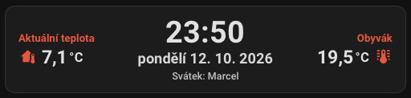

# Ek Digital Clock

[](https://github.com/hacs/integration)
[](https://github.com/elvisek2020/hacs-ek_digital_clock/releases)
[](https://github.com/elvisek2020/hacs-ek_digital_clock/actions/workflows/validate.yml)
[](LICENSE)

[](https://my.home-assistant.io/redirect/hacs_repository/?owner=elvisek2020&repository=hacs-ek_digital_clock&category=plugin)

Moderní digitální hodiny pro dashboard Home Assistantu s jmeninami, státními svátky
a teplotami po stranách. Všechno se nastaví v grafickém editoru, YAML není potřeba.



- Digitální čas a datum (Luxon formáty + předvolby v editoru)
- České **jmeniny** (`namedays-cs`, offline v bundle)
- České **státní svátky** a volitelné **významné dny** (`holidays-cs`, offline)
- Volitelné **teploty** vlevo/vpravo (entita, popisek, ikona, barva)
- `tap_action` / `hold_action` / `double_tap_action`
- Motiv HA, vlastní barva pozadí/textu, velikost karty

Bez teplotních entit zůstane klasický vycentrovaný digi clock.

## Předpoklady a závislosti

- Home Assistant 2024.1 nebo novější.
- Pro teploty po stranách libovolné senzory teploty (`sensor.*`). Bez nich karta ukazuje jen čas a datum.
- Jmeniny a svátky jsou přímo v kartě, žádná další integrace ani přístup na internet nejsou potřeba.

## Instalace

### HACS (doporučeno)

1. HACS → tři tečky vpravo nahoře → **Custom repositories**
2. Vlož URL `https://github.com/elvisek2020/hacs-ek_digital_clock`, kategorie **Dashboard**
3. Nainstaluj **Ek Digital Clock**
4. Obnov stránku prohlížeče bez cache.
5. Dashboard → **Přidat kartu** → Ek Digital Clock → nastav v UI

HACS nabízí aktualizace z GitHub releases.

### Ručně

1. Stáhni `ek-digital-clock.js` z posledního [release](https://github.com/elvisek2020/hacs-ek_digital_clock/releases) do `/config/www/`
2. Nastavení → Dashboards → Resources → `/local/ek-digital-clock.js` (**JavaScript module**)
3. Přidej kartu přes UI: `custom:ek-digital-clock`

## Konfigurace

Vše nastavíš v grafickém editoru karty. YAML je potřeba jen pokud chceš.

```yaml
type: custom:ek-digital-clock
time_format: HH:mm
date_format: cccc dd. L.
show_nameday: true
nameday_prefix: 'Svátek:'
show_public_holiday: true
show_significant_day: false
size: normal
left_temperature:
  entity: sensor.venkovni_teplota
  name: Venkovní teplota
  icon: mdi:home-thermometer
  icon_color: red
  precision: 1
right_temperature:
  entity: sensor.teplota_obyvak
  name: Obývák
  icon: mdi:thermometer
  icon_color: red
  unit: °C
  show_unit: true
tap_action:
  action: navigate
  navigation_path: /lovelace/kalendar
```

### Volby

| Volba | Popis |
| --- | --- |
| `time_format` / `date_format` | Luxon `toFormat` string |
| `locale` / `time_zone` | Override HA locale / zóny |
| `show_nameday` | Jmeniny pod datem |
| `nameday_prefix` | Text před jmeninami (výchozí `Svátek:`) |
| `show_public_holiday` | Státní svátek (jen když dnes je) |
| `show_significant_day` | Významný den |
| `left_temperature` / `right_temperature` | Slot: `entity`, `name`, `icon`, `icon_color`, `precision`, `unit`, `show_unit` |
| `background_color` / `text_color` | Barva — název HA barvy (`red`, `primary`) nebo CSS (`#e53935`) |
| `theme` | HA motiv (respektuje light/dark varianty motivu) |
| `size` | `compact` \| `normal` \| `large` |
| `tap_action` / `hold_action` / `double_tap_action` | Standardní HA akce |

Jednotka se bere z entity (`unit_of_measurement`). Pokud ji entita nemá,
nastav `unit` ručně; `show_unit: false` ji skryje.

## Vývoj

```bash
npm install
npm run typecheck
npm run build
```

Výstup: `dist/ek-digital-clock.js`. Pro testování v HA ho zkopíruj do `/config/www/`
a resource načti s `?v=…`, ať prohlížeč nepoužije starou verzi z cache.

## Vydání verze

1. Zvedni verzi v `package.json` (SemVer). Build ji sám vloží do karty.
2. Doplň sekci `## vX.Y.Z — RRRR-MM-DD` do `CHANGELOG.md`.
3. Commit `Release vX.Y.Z: …`, `git tag vX.Y.Z`, push commitu i tagu.
4. GitHub Actions sestaví `ek-digital-clock.js`, vytvoří release s textem z CHANGELOG a HACS nabídne aktualizaci.

## Známá omezení

- Jmeniny a svátky jsou jen české.
- Popisky teplot uložené ve verzi 1.0.1 a starší mohou mít ztracené mezery. Stačí je v editoru přepsat.
- Barva zadaná jako hex (`#e53935`) funguje, ale výběr barvy v editoru ji nezobrazí jako vybranou.
- Bundle má kolem 250 KB, protože obsahuje Luxon a kalendářní data.

## Autor

**[elvisek2020](https://github.com/elvisek2020)** — inspirováno kartou
[wassy92x/lovelace-digital-clock](https://github.com/wassy92x/lovelace-digital-clock),
přepsáno od nuly pro aktuální Home Assistant (Lit 3, Sections view, tap/hold akce,
jmeniny a svátky). Licence MIT.
